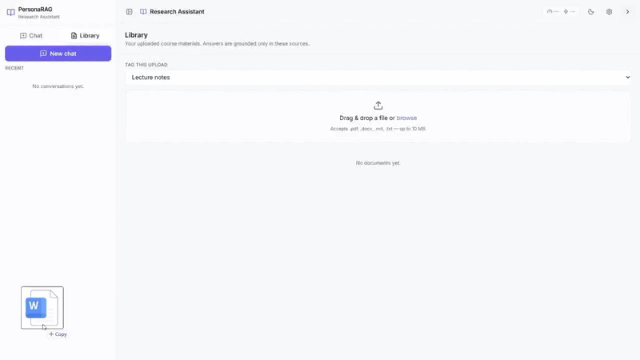

# PersonaRAG: A Lightweight Research Assistant for students



## What is this?

- PersonaRAG is a chatbot for students. You upload your own study materials (slides, papers, textbook chapters), and the chatbot answers only from those files. 
- Answers are always cited, gaps are admitted rather than invented, and plagiarism or AI-hiding requests are refused.
## Why I built it

When I study, I have a lot of PDFs and notes. ChatGPT is helpful, but it sometimes sounds sure about things that are wrong. I wanted a tool that sticks to my materials.

This is also a learning project. I wanted to understand how a real RAG system works, so I built the main parts myself (search, reranking, caching, routing) and tested whether each part actually helps instead of assuming it does.

## How well does it work?

I tested the system on a set of questions with known answers. Everything below comes from real runs saved in [`backend/eval/reports/runs/`](backend/eval/reports/runs/):
retrieval run [`20261021-223801`](backend/eval/reports/runs/20261021-223801/summary.md) and answer run [`20261021-234059`](backend/eval/reports/runs/20261021-234059/summary.md).

### Test setup

- Documents: 400 chunks from 2 lecture notes + 14 sections of *Dive into Deep Learning* (CC BY-SA).
- Questions: 81 questions, each with the exact quote that proves the answer. They include single-source, multi-chapter, out-of-scope, and academic-integrity questions.
- Relevant means "this chunk contains the evidence", not just "this chunk comes from the right file".
- Numbers have 95% bootstrap confidence intervals (see the full files for the ranges).
- Models for these runs: `gpt-6-luna` (chat, utility, and judge) and `text-embedding-3-large`.

### Part 1: Finding the right chunks (top 5 results)

Hit@5 = the evidence appears in the top 5. MRR = how high the first correct result ranks (closer to 1 is better).

| Setup | Hit@5 | MRR | Speed (median) |
|---|---|---|---|
| Keyword only (BM25) | 85.3% | 0.707 | 4 ms |
| Meaning only (dense) | 89.3% | 0.702 | 333 ms |
| Dense + MMR | 77.3% | 0.668 | 342 ms |
| Hybrid (BM25 + dense) | 89.3% | 0.744 | 330 ms |
| Hybrid + MMR | 77.3% | 0.679 | 334 ms |
| Hybrid + multi-query | 92.0% | 0.746 | 3.3 s |
| Hybrid + rerank | 93.3% | 0.839 | 2.8 s |
| **Full pipeline** | **100%** | **0.898** | 7.0 s |

### Part 2: Final answers (81 questions)

| Setup | Faithful | Correct | Wrongly said "not found" | Speed (median) |
|---|---|---|---|---|
| Dense | 95.8% | 95.3% | 1.3% | 4.8 s |
| Hybrid | 94.7% | 96.7% | 2.7% | 5.0 s |
| Hybrid + rerank | 95.3% | 96.0% | 2.7% | 7.3 s |
| **Full pipeline** | **98.0%** | **100%** | **0%** | 11.2 s |

Out-of-scope questions (4/4) and refusal questions (2/2) were handled correctly in every setup.

## Tech stack

| Layer | Tools |
|---|---|
| AI models | OpenAI `gpt-4.1`, `gpt-4.1-mini`, `text-embedding-3-large` |
| Safety | OpenAI Moderation (`omni-moderation-latest`) |
| Retrieval | rank-bm25, langchain-chroma, custom RRF + reranker |
| Backend | FastAPI, Uvicorn, Pydantic v2, SQLite |
| Observability | LangSmith, custom usage repository |
| Frontend | Next.js 14, React 18, TypeScript, Tailwind, SWR, Lucide |
| Evaluation | Evidence-labelled test set, IR metrics, LLM judge, bootstrap CIs |
| Deploy | Docker, docker-compose |

---

## Getting started

### 1. Backend

```bash
cd backend
python -m venv .venv
. .venv/Scripts/activate       # PowerShell: .venv\Scripts\Activate.ps1
pip install -e .

cp .env.example .env           # then paste your OPENAI_API_KEY
uvicorn app.main:app --reload
```

The API runs at [http://localhost:8000/api/v1](http://localhost:8000/api/v1). API docs are at `/docs`.

### 2. Frontend

```bash
cd frontend
npm install
cp .env.local.example .env.local
npm run dev
```

Open [http://localhost:3000](http://localhost:3000).

### 3. Docker

```bash
docker compose up --build
```

---

## Explore the code

For more implementation details, see the [backend README](./backend/README.md) and [frontend README](./frontend/README.md).

### What I learned

- The full pipeline was the best. It beat the simple dense baseline on both ranking (MRR 0.898 vs 0.702) and answer correctness (100% vs 95.3%).
- The reranker helped the most for ranking. Hybrid alone and multi-query alone did not show a clear improvement on this small dataset.
- MMR alone made things worse. It tries to make results more diverse, but it pushed out similar chunks that had the evidence (Hit@5 dropped from 89.3% to 77.3%). It only worked well as part of the full pipeline.
- Good retrieval leads to good answers. Most wrong answers happened when the evidence never reached the prompt. The full pipeline found it and got all of those right.
- Quality costs speed. The full pipeline is about 2.3× slower than dense (11.2 s vs 4.8 s). Using fewer query variations or reranking fewer results would help.

### Limitations

- The same model writes and judges answers. This can make scores look better than they really are. I have not yet compared the judge with human labels, so treat faithfulness and correctness as upper limits.
- Cost was not measured. `gpt-6-luna` is not in my pricing table, so reports show about $0 for these runs.
- Small dataset. One corpus of 400 chunks. Results may be different on your own materials.

## License

MIT. See [LICENSE](./LICENSE).
